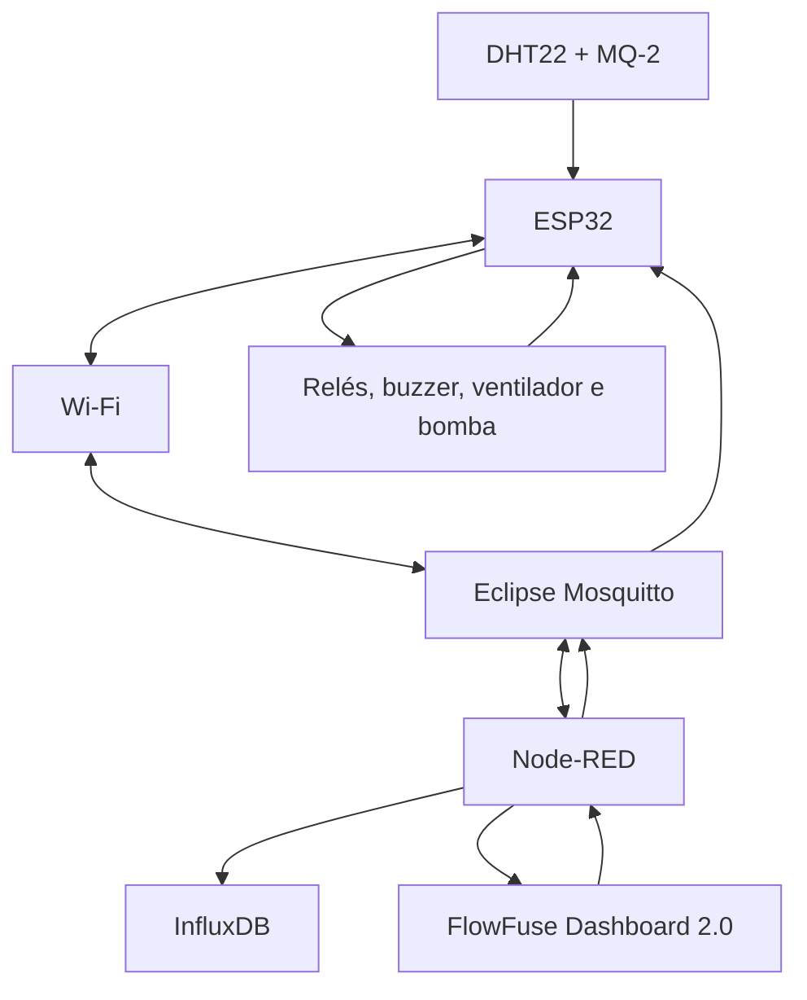
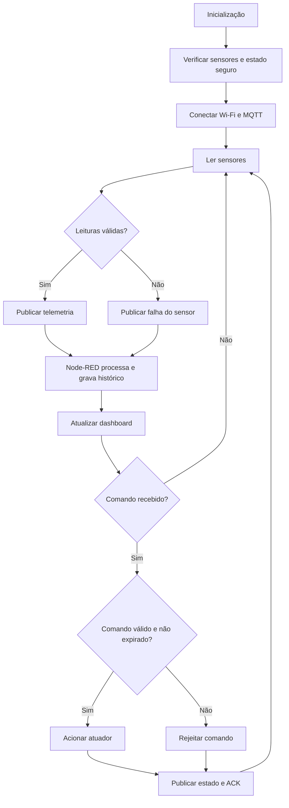

# Arquitetura do Sistema de Monitoramento IoT

**Projeto:** attwita  
**Etapa:** 02 — Planejamento da arquitetura  
**Status:** Proposta arquitetural — depende de aprovação e validação de hardware.

## 1. Objetivo

Construir um sistema IoT que colete temperatura, umidade e dados de um sensor de gás, envie telemetria por MQTT, permita controlar atuadores remotamente e apresente dados atuais, históricos e alertas em dashboards Web e smartphone.

## 2. Decisões arquiteturais

| Camada | Tecnologia / componente | Responsabilidade |
|---|---|---|
| Controlador | ESP32 DevKit (modelo exato a confirmar) | Leitura, validação local, Wi-Fi e controle |
| Sensores | DHT22 e MQ-2 | Temperatura/umidade e resposta a gases/fumaça |
| Atuadores | Relés, buzzer, ventilador e bomba | Sinalização e acionamento de cargas |
| Alimentação | Fonte DC dimensionada + conversor LM2596 quando compatível | Alimentação separada de lógica e cargas |
| Transporte | Wi-Fi | Conectividade do ESP32 |
| Mensageria | MQTT | Telemetria e comandos bidirecionais |
| Broker | Eclipse Mosquitto | Distribuição de mensagens e sessões |
| Orquestração | Node-RED | Validação, regras, alertas e integração |
| Histórico | InfluxDB | Armazenamento de séries temporais |
| Interface | FlowFuse Dashboard 2.0 | Dashboard responsivo Web/smartphone |

A escolha do ESP32 preserva a família do firmware de referência e oferece recursos de GPIO e ADC. O modelo exato da placa deve ser confirmado antes do mapeamento de pinos.

## 3. Diagrama da arquitetura



## 4. Fluxo de telemetria e comandos

1. O ESP32 inicializa sensores e saídas em estado seguro.
2. Conecta-se ao Wi-Fi e ao broker MQTT.
3. Lê e valida os sensores nos intervalos definidos.
4. Publica as medições em tópicos MQTT.
5. O Node-RED valida, processa e armazena as medições.
6. O dashboard apresenta valores, conexão, estados e alertas.
7. Um usuário envia um comando pelo dashboard.
8. O Node-RED valida a solicitação e publica o comando MQTT.
9. O ESP32 valida o comando, aciona a saída e publica confirmação.
10. O Node-RED atualiza o estado apresentado no dashboard.



## 5. Padrão de tópicos MQTT

Prefixo: `attwita/v1/device-01/`

| Sufixo | Direção | Uso |
|---|---|---|
| `sensors/temperature` | ESP32 → broker | Temperatura |
| `sensors/humidity` | ESP32 → broker | Umidade |
| `sensors/gas` | ESP32 → broker | Leitura bruta e classificação experimental do MQ-2 |
| `actuators/pump/set` | Node-RED → ESP32 | Solicitar estado da bomba |
| `actuators/fan/set` | Node-RED → ESP32 | Solicitar estado do ventilador |
| `actuators/relay/set` | Node-RED → ESP32 | Solicitar estado dos relés |
| `actuators/buzzer/set` | Node-RED → ESP32 | Solicitar estado do buzzer |
| `state/actuators` | ESP32 → broker | Estado confirmado das saídas |
| `status` | ESP32 → broker | Estado e disponibilidade do dispositivo |
| `events/alerts` | ESP32 → broker | Eventos e falhas |
| `commands/ack` | ESP32 → broker | Confirmação ou rejeição de comandos |

### Payload de telemetria

Temperatura:

```json
{
  "value": 24.5,
  "unit": "C",
  "timestamp": "2026-11-25T14:00:00Z"
}
```

Umidade:

```json
{
  "value": 60,
  "unit": "%",
  "timestamp": "2026-11-25T14:00:00Z"
}
```

MQ-2:

```json
{
  "raw": 1250,
  "level": "normal",
  "timestamp": "2026-11-25T14:00:00Z"
}
```

O valor `raw` é ilustrativo. Não apresentar ppm como medição calibrada antes de caracterização e calibração do sensor.

### Payload de comando

```json
{
  "command_id": "pump-001",
  "state": "ON",
  "source": "dashboard",
  "issued_at": 1795615200000,
  "ttl_ms": 10000
}
```

O dispositivo deve validar tópico, formato, estado permitido e validade temporal. Comandos não devem ser publicados com retenção. O Node-RED deve incluir `issued_at` (Unix epoch em milissegundos) e `ttl_ms`; o firmware rejeita comandos expirados ou recebidos antes da sincronização NTP. O callback PubSubClient não expõe o bit RETAIN ao sketch, portanto a aplicação publicadora deve garantir `retain=false`.

## 6. Intervalos e QoS propostos

| Dado / evento | Intervalo | QoS |
|---|---:|---:|
| DHT22 (temperatura e umidade) | 5 s | 0 |
| MQ-2 (leitura bruta) | 2 s | 0 |
| Status do dispositivo | 10 s | 1 |
| Estado de atuadores | Em cada alteração | 1 |
| Alertas | Imediato | 1 |
| Comandos | Imediato | 1 |
| ACK de comando | Imediato | 1 |

O DHT22 possui intervalo mínimo de amostragem de 2 segundos. O intervalo de 5 segundos é uma proposta inicial.

Estado/status podem ser retidos para que novos assinantes conheçam o último estado publicado. Telemetria e comandos não serão retidos. O broker usará Last Will and Testament para indicar desconexão inesperada.

## 7. Alimentação e condicionamento elétrico

Arquitetura de alimentação proposta, ainda sem dimensionamento:

- Uma fonte DC principal será escolhida depois de confirmar tensão e corrente nominais de cada carga.
- O ramo de lógica alimentará a placa ESP32 e sensores conforme seus requisitos.
- O ramo de potência alimentará bomba e ventilador de acordo com suas etiquetas/datasheets.
- O LM2596 poderá gerar uma tensão regulada para um ramo compatível, após cálculo de corrente, dissipação e ajuste de saída.
- A saída analógica do MQ-2 deverá ser condicionada para nunca exceder a faixa permitida no ADC do ESP32.
- Motores/cargas indutivas precisarão de driver apropriado e proteção contra tensão reversa.
- A compatibilidade de entrada dos módulos de relé com lógica de 3,3 V deverá ser confirmada.
- O IRFZ44N não será ligado diretamente ao GPIO de 3,3 V sem driver adequado; será avaliado MOSFET logic-level ou outra etapa de acionamento.
- A ligação de terras, isolamento e proteções dependerão do circuito final e das cargas escolhidas.

**Não usar este documento como esquema de ligação.** Nenhum GPIO, resistor, bitola, fusível ou dimensionamento de fonte está aprovado nesta etapa.

## 8. Regras de tratamento de falhas e segurança

- Inicializar bomba, ventilador e demais saídas em estado seguro (desligado, salvo justificativa técnica validada).
- Reconectar Wi-Fi e MQTT com espera progressiva, sem laços bloqueantes.
- Não publicar leitura inválida como se fosse válida; informar falha e qualidade do dado.
- Rejeitar comandos malformados, desconhecidos ou expirados.
- Confirmar acionamento somente após atualização do estado no firmware.
- Usar autenticação, ACL por tópico e TLS no acesso remoto ao broker.
- Não permitir acesso anônimo ao broker.
- Não expor a porta MQTT sem proteção diretamente à internet.
- Não executar automações de segurança baseadas em limites de gás antes da calibração e validação dos sensores.
- Registrar falhas, reinicializações, perda de conexão e comandos rejeitados.

## 9. Dashboard e histórico

O FlowFuse Dashboard 2.0 será uma única interface responsiva para desktop, tablet e smartphone, com:

- Visão geral de temperatura, umidade e gás.
- Estados de Wi-Fi, MQTT e sensores.
- Estado confirmado dos relés, bomba, ventilador e buzzer.
- Gráficos históricos.
- Alertas e notificações.
- Controles remotos com retorno de confirmação.

O Node-RED encaminhará medições ao InfluxDB para armazenamento temporal e consultará o histórico para gráficos.

## 10. Itens que dependem de confirmação na etapa de hardware

- Modelo exato da placa ESP32.
- Modelo e versão do módulo MQ-2.
- Módulos de relé e compatibilidade com 3,3 V.
- Tensão e corrente da bomba e do ventilador.
- Tensão e corrente do buzzer.
- Fonte principal disponível.
- Drivers, diodos, resistores e proteções.
- Disponibilidade e fidelidade dos componentes no Wokwi.
- Mapeamento definitivo de GPIOs e esquema elétrico.

## 11. Referências técnicas

- Espressif — ESP32-DevKitC: https://docs.espressif.com/projects/esp-dev-kits/en/latest/esp32/esp32-devkitc/user_guide.html
- Aosong — AM2302/DHT22: https://www.aosong.com/uploadfiles/2025/04/20250417105409216.pdf
- Hanwei — MQ-2: https://www.datasheethub.com/wp-content/uploads/2022/10/605-00008-MQ-2-Datasheet-370464.pdf
- Texas Instruments — LM2596: https://www.ti.com/lit/ds/symlink/lm2596.pdf
- Infineon — IRFZ44N: https://www.infineon.com/assets/row/public/documents/24/49/infineon-irfz44n-datasheet-en.pdf?fileId=5546d462533600a40153563b3a9f220d
- Eclipse Mosquitto: https://mosquitto.org/documentation/
- FlowFuse Dashboard 2.0: https://dashboard.flowfuse.com/

---

**Limite desta etapa:** esta arquitetura é uma proposta técnica documentada. Ela não comprova compatibilidade física, compilação, conectividade ou funcionamento dos componentes. Essas validações pertencem às etapas de hardware, firmware e integração.
